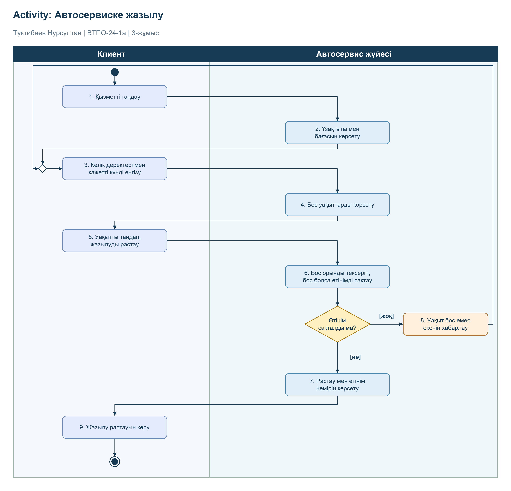
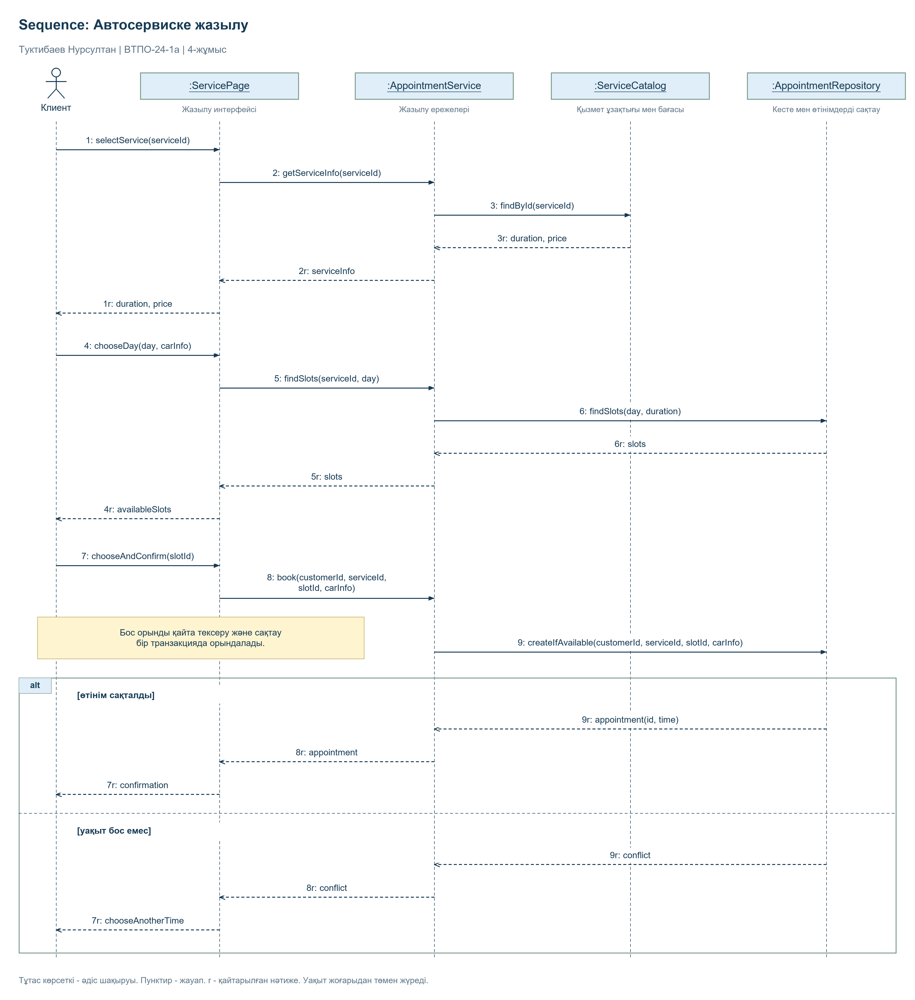

# Автосервиске жазылу жүйесі

**Диплом тақырыбы:** «Запись в автосервис» / «Автосервиске жазылу»  
**Автор:** Туктибаев Нурсултан  
**Топ:** ВТПО-24-1а

## Мәселе және мақсат

Автосервиске телефон арқылы жазылғанда клиент қызмет бағасын және бос уақытты бірден біле алмауы мүмкін. Бір уақытқа бірнеше өтінім түссе, кестеде қайшылық пайда болады. Жобаның мақсаты — клиентке қызмет пен уақытты таңдауға мүмкіндік беріп, өтінімді бос орын бар кезде ғана сақтау.

## Қатысушылар

- **Клиент:** қызметті, күнді және уақытты таңдайды, көлік деректерін енгізеді, жазылуды растайды.
- **Әкімші:** қызметтерді, бағаларды және жұмыс кестесін басқарады (осы негізгі сценарийден тыс).

## Негізгі сценарий

**Автосервиске жазылу:** клиент қызметті таңдайды, жүйе ұзақтығы мен бағасын көрсетеді. Клиент көлігі туралы деректер мен күнді енгізеді, бос уақытты таңдап, өтінімді растайды. Жүйе уақытты қайта тексеріп, бос болса өтінімді сақтайды; уақытты басқа клиент алып қойса, басқа күнді не уақытты таңдауды ұсынады.

Бұл репозиторийде жобалау материалдары берілген. Жұмыс істейтін қосымша әлі іске асырылмаған; болашақ кодқа `src/` бумасы дайындалған.

## Диаграммалар

### 1. Use Case

Кейінгі жобалау кезеңіне арналған орын.

### 2. Class

Кейінгі жобалау кезеңіне арналған орын.

### 3. Activity



[Өңделетін Activity файлы (.drawio)](docs/diagrams/03-activity.drawio)

Диаграммада екі swimlane бар: **Клиент** және **Автосервис жүйесі**. Қара шеңбер — басталу, қос шеңбер — аяқталу, дөңгеленген тіктөртбұрыштар — 9 әрекет. «Өтінім сақталды ма?» шешімінің `[иә]` тармағы растауға, `[жоқ]` тармағы бос емес уақыт туралы хабарламаға апарады. Одан кейін ағын біріктіру ромбы арқылы күнді қайта таңдауға оралады.

Бос уақытты көрсету мен нақты сақтау арасында басқа клиент сол уақытты алуы мүмкін. Сондықтан 6-әрекетте бос орынды қайта тексеру мен сақтау бір атомарлық операция ретінде жобаланған.

### 4. Sequence



[Өңделетін Sequence файлы (.drawio)](docs/diagrams/04-sequence.drawio)

Бұл диаграмма 3-жұмыстағы **сол сценарийді** объектілер арасындағы хабарламалармен нақтылайды. Сол жақта клиент, одан кейін төрт объект орналасқан: `:ServicePage`, `:AppointmentService`, `:ServiceCatalog`, `:AppointmentRepository`. Тік пунктирлер — өмір сызықтары; уақыт жоғарыдан төмен жүреді. Тұтас көрсеткі — әдісті шақыру, пунктир көрсеткі — жауап; `r` белгісі қайтарылған нәтижені білдіреді.

| № | Әдіс | Мақсаты |
|---|---|---|
| 1 | `selectService(serviceId)` | Клиент қызметті таңдайды. |
| 2 | `getServiceInfo(serviceId)` | Интерфейс қызмет туралы ақпаратты сұрайды. |
| 3 | `findById(serviceId)` | Каталог қызмет ұзақтығы мен бағасын қайтарады. |
| 4 | `chooseDay(day, carInfo)` | Клиент күн мен көлік деректерін енгізеді. |
| 5 | `findSlots(serviceId, day)` | Жазылу сервисі бос уақыттарды іздейді. |
| 6 | `findSlots(day, duration)` | Репозиторий қызмет ұзақтығы мен кестеге сәйкес бос уақыттарды қайтарады. |
| 7 | `chooseAndConfirm(slotId)` | Клиент уақытты таңдап, өтінімді растайды. |
| 8 | `book(customerId, serviceId, slotId, carInfo)` | Интерфейс өтінімді өңдеуге жібереді. |
| 9 | `createIfAvailable(customerId, serviceId, slotId, carInfo)` | Репозиторий уақытты қайта тексеріп, бос болса өтінімді бір транзакцияда сақтайды. |

`alt` фрагментінде екі нәтиже бар:

- `[өтінім сақталды]` — өтінім нөмірі мен уақыты клиентке қайтарылады; Activity-дегі `[иә]` тармағына сәйкес.
- `[уақыт бос емес]` — `conflict` қайтарылады, интерфейс басқа уақыт таңдауды ұсынады; Activity-дегі `[жоқ]` тармағына сәйкес. Қайталанатын таңдау Activity-де көрсетілген, Sequence бір жазылу әрекетін көрсетеді.

`serviceId` — қызмет нөмірі, `customerId` — жүйеге белгілі клиент нөмірі, `slotId` — таңдалған уақыт нөмірі, `day` — күн, `duration` — қызмет ұзақтығы, `carInfo` — көлік маркасы, моделі және мемлекеттік нөмірі. Клиенттің анықталғаны және енгізілген деректердің дұрыс екені осы сценарийдің алғышарттары; авторизация бөлек сценарийге жатады.

## Репозиторий құрылымы

```text
docs/
  diagrams/
    03-activity.drawio
    03-activity.png
    04-sequence.drawio
    04-sequence.png
src/
  .gitkeep
README.md
.gitignore
```

PNG файлдарын GitHub-та көруге болады. `.drawio` файлдарын diagrams.net редакторында ашып, әр элементті өңдеуге болады. 3 және 4-жұмыс бөлек коммиттерде сақталған.
